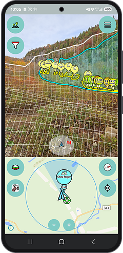
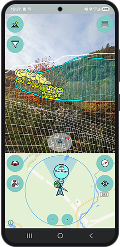
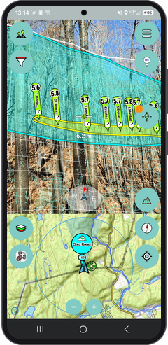
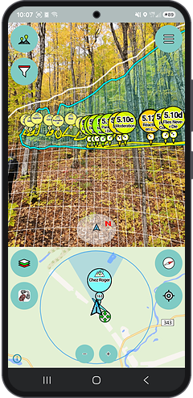
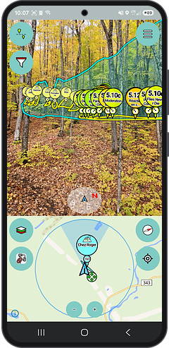

# ClimbTheWorld-Android

Rock climbing frontend for OpenStreetMap.

* Install it with [Obtainium or ObtainX](#with-obtainium-or-obtainx) to get updates automatically,
  or download the APK from the [latest release](https://github.com/xyz-relativity/ClimbTheWorld-Android/releases/latest).
* Support us on Patreon: https://www.patreon.com/climb_the_world?fan_landing=true

## Install

ClimbTheWorld is published as an APK on its
[GitHub releases](https://github.com/xyz-relativity/ClimbTheWorld-Android/releases), in two
builds:

* `ClimbTheWorld-Release.apk`, all free software.
* `ClimbTheWorld-NonFOSS-Release.apk`, the same with what needs libraries that are not free
  software. So far, that is Google's
  [ARCore](https://play.google.com/store/apps/details?id=com.google.ar.core), on the phones that
  support it: the A.R. view tracks the camera with it, steadier than with the sensors, and can be
  aligned on mapped routes once close to them, and the node editor can place nodes in A.R. **Use ARCore** in the
  settings turns it off in the A.R. view.

Either installs over the other, keeping your downloads and changes.

### With Obtainium or ObtainX

[Obtainium](https://github.com/ImranR98/Obtainium) and its fork
[ObtainX](https://github.com/bikram-agarwal/ObtainX) install apps straight from their GitHub
releases, and let you know when a new version is out. The steps are the same in both.

1. Install Obtainium (from [GitHub](https://github.com/ImranR98/Obtainium/releases),
   [IzzyOnDroid](https://apt.izzysoft.de/fdroid/index/apk/dev.imranr.obtainium) or
   [F-Droid](https://f-droid.org/packages/dev.imranr.obtainium.fdroid/)) or ObtainX (from
   [GitHub](https://github.com/bikram-agarwal/ObtainX/releases/latest) or
   [F-Droid](https://f-droid.org/packages/dev.bikram.obtainx/)).
2. On the phone, open
   [this link](https://apps.obtainium.imranr.dev/redirect?r=obtainium://add/https://github.com/xyz-relativity/ClimbTheWorld-Android):
   it opens the **Add app** screen with ClimbTheWorld filled in. Or open **Add app** yourself, and
   enter `https://github.com/xyz-relativity/ClimbTheWorld-Android` as the **App source URL**.
3. Pick the build in **Filter links by regular expression** (**Filter APKs by regular expression**
   in older versions): `ClimbTheWorld-Release` for the free software one, or `NonFOSS` for the
   other. Keep the other options as they are, and tap **Add**.
4. Tap **Install** on the app's page, and allow Obtainium or ObtainX to install apps when Android
   asks.

From then on, Obtainium or ObtainX checks for new releases in the background and notifies you of
them, to install with **Update**.

If you added ClimbTheWorld before there were two builds, set the same filter in its options on
its page, so that updates keep to the build you want.

### By hand

Download `ClimbTheWorld-Release.apk`, or `ClimbTheWorld-NonFOSS-Release.apk`, from the
[latest release](https://github.com/xyz-relativity/ClimbTheWorld-Android/releases/latest), open it
on the phone, and allow the browser or file manager to install apps when Android asks.

New versions then have to be downloaded and installed the same way.

## Screenshots

### Augmented reality

Point the camera at the rock to see the crags and routes from OpenStreetMap where they are.

|  |  |  |  |  |
|:---:|:---:|:---:|:---:|:---:|
| From the approach | From the road | Close to a crag | Virtual terrain | No horizon |
